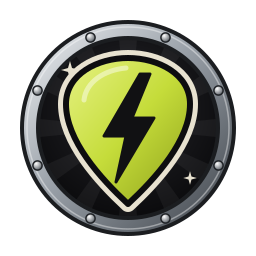
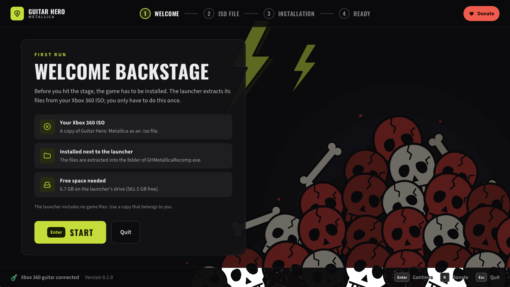
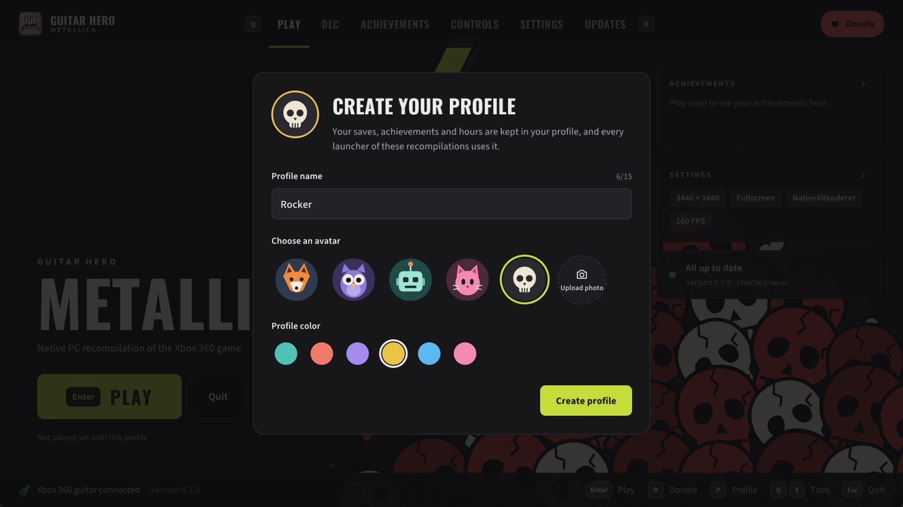
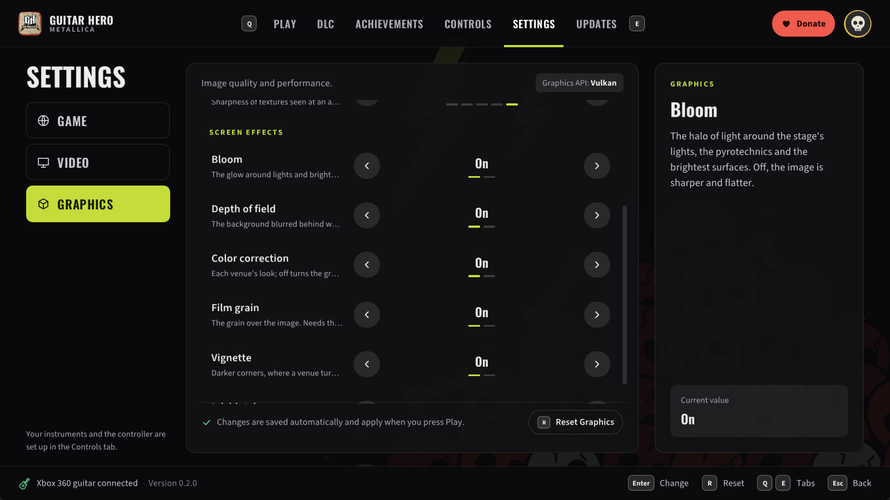
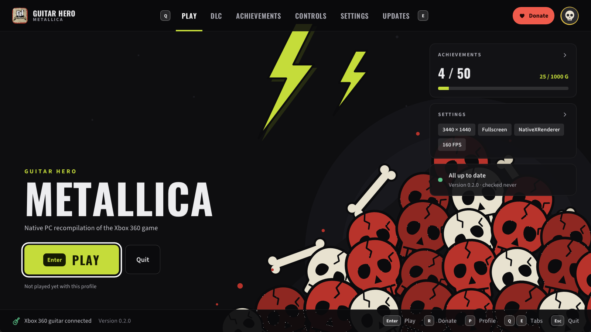
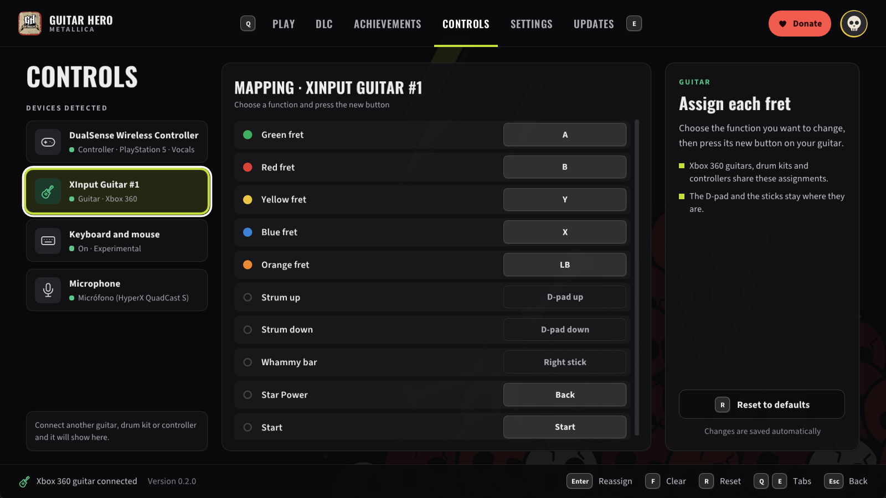
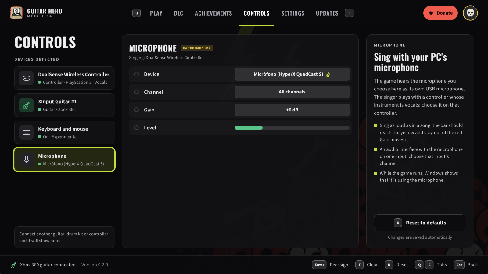
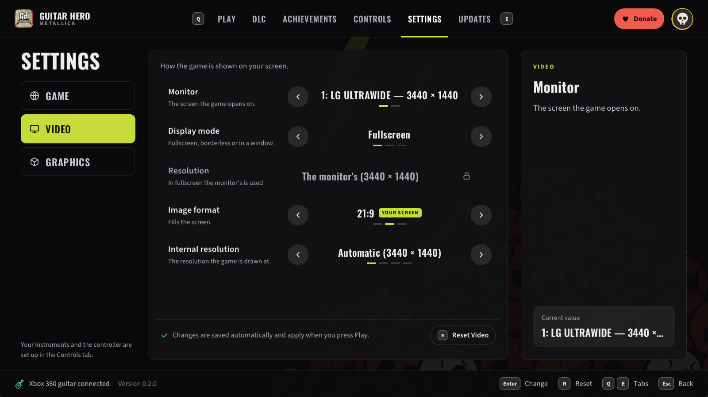
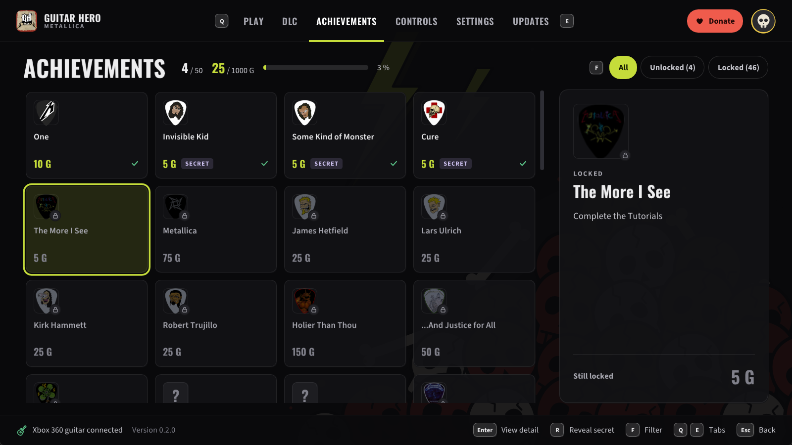

  

<h1 align="center">GHMetalRecomp</h1>

  
  
  
  
  

🎸 **Play Guitar Hero: Metallica on your PC, natively.** The Xbox 360 game by Neversoft (2009), recompiled to run
directly on Windows: no emulator to set up, sharp graphics, wide screens, high frame rates, and your Xbox 360
guitar.

> [!IMPORTANT]
> 💿 **You need your own original copy of the game.** This project does not include any of the game's files, and
> never will.
> - To play, you need an Xbox 360 copy of *Guitar Hero: Metallica* that you own (the USA / Europe disc).
> - You make an image (ISO) of your own disc, and the launcher installs the game from it.
> - Please do not ask for the game's files, and do not share them or links to them.
>
> This project is not affiliated with or endorsed by Microsoft, Activision, Neversoft or Metallica.

> [!NOTE]
> 🤘 **Beta.** Songs have been played from start to finish with an Xbox 360 guitar, on guitar and bass parts, and sung
> with a PC microphone (new and experimental). Drums have not been tested yet. If something goes wrong, please
> [tell us](#-reporting-a-problem)!

> [!WARNING]
> ⚠️ **Not tested yet:** AMD graphics cards, and Wii or PS3 instruments (guitars and drum kits). If you play with any
> of them and something goes wrong, please report it in [issues](https://github.com/ElGuslml/GHMetalRecomp/issues) or
> on [Discord](https://discord.gg/XQtM5TmNs8).

## 🎮 How to play

1. **Download** the latest version from [Releases](https://github.com/ElGuslml/GHMetalRecomp/releases/latest):
   - **the installer** (`GHMetalRecomp-...-setup.exe`): installs for your Windows user, no administrator rights
     needed, with a Start menu shortcut; or
   - **the zip** (`GHMetalRecomp-...-win64.zip`): extract it into any folder you can write to (not `Program Files`).
2. **Open GH Metallica Launcher.** The first time, it asks for the ISO of your game, checks it and installs the game
   files (about 7.2 GB), then asks you to create your profile. You only do this once.
3. **Pick your settings and press PLAY.** 🎉
4. **Calibrate:** in the game's options, run the audio and video calibration once, so that the notes match what you
   hear on your own speakers or headphones.

  
  

The first run: the launcher checks your ISO, installs the game from it, and asks for your profile.

From then on, the launcher keeps itself up to date: when a new version comes out, it offers to install it for you.

### 💻 What you need

- Windows 10 or 11 (64-bit).
- A graphics card with up-to-date drivers that support Vulkan (practically any card from the last ten years).
- The [Microsoft Visual C++ Redistributable](https://aka.ms/vs/17/release/vc_redist.x64.exe) (most PCs already
  have it).
- An Xbox 360 guitar. Any other controller works as a guitar too, and so does the keyboard.
- To sing (experimental): any microphone connected to the PC, and a controller for the singer.

## ✨ Features

- 🎸 **Your guitar:** an Xbox 360 guitar plays as on the console, whammy bar and Star Power included. Any other
  controller is a guitar too, and the keyboard can be one (experimental: turn it on in the launcher's Keyboard page;
  frets on D F J K L).
- 🎮 **Auto-strum, GH2 / GH3 style:** on a controller or the keyboard, each fret strums as you press it, so you play
  with the frets alone (a chord is one strum). Turn it on in the launcher's Controls tab; it only acts during a song,
  so the menus work as usual. The whammy bar is the right stick, pushed to either side.
- 🎤 **Sing (experimental):** any microphone on your PC is the game's USB microphone. Choose it in the launcher, and
  choose which controller sings.
- 🖥️ **Sharp, native graphics:** the game is drawn by your graphics card at your screen's resolution, with smooth
  edges (antialiasing) and sharper textures.
- ⚡ **High frame rates:** 60 FPS as on the console, or 120, 144, 160, 165 or 240 FPS if your monitor supports it
  (experimental). The songs keep their speed and stay in sync.
- 📺 **Wide and ultrawide screens:** the stage fills 16:9, 21:9 and wider screens, while the note highway, the HUD and
  the menus keep their shape in the center.
- 🎶 **Downloadable content:** install your own Xbox 360 DLC packages (the *Death Magnetic* album) from the launcher.
- 👤 **Profiles:** your saves, achievements and playtime in a profile shared by all the ElGus Recomps launchers.
- 👥 **Play together:** the controller that presses a button at the title screen plays with your profile; the other
  controllers join as its guests, as on the Xbox 360.
- 🏆 **Achievements:** a notification when you unlock one, and all 50 in the launcher or with F7 in the game.
- 🌍 **Languages:** English, French, German, Italian and Spanish.
- 🔄 **Automatic updates** from this page.

## 🔧 Better than the original

Some problems come from the game itself and happen on an Xbox 360 too. They are fixed here, and each fix can be
turned off (the [notes](docs/README.md) say how):

- ⏱️ **Songs drifting out of sync.** On the later Xbox 360 models the music slowly falls behind the notes during a
  song, about 150 ms a minute, until you pause: the game corrects its clock for the first consoles' timer, which
  runs 0.25 % slow, and the later ones' does not. Here the game's clock runs at the right rate, and whole songs stay
  in sync ([details](docs/song-sync.md)).
- 👏 **Crowd claps out of time.** With Star Power on, the crowd claps on the beat, but the claps ignored your audio
  calibration and came late by it. They follow the calibration now, as the music does ([details](docs/crowd-claps.md)).
- 🎛️ **Screen effects you can turn off.** Bloom, depth of field, film grain, color correction, vignette and the ink
  blotches each have a switch in the launcher's **Settings → Graphics** (all on by default, as on the console; with
  the color correction off, the grain is off too) ([details](docs/screen-effects.md)).

  

## 🧭 GH Metallica Launcher

Everything is set up from **GH Metallica Launcher**, with the mouse, the keyboard or a controller:

  

| Tab | What you find there |
|---|---|
| ▶️ **Play** | Start the game, and see your settings, achievements and updates at a glance. |
| 🎶 **DLC** | Install your downloadable content packages, and see the installed ones. |
| 🏆 **Achievements** | All 50 achievements, the ones you have unlocked and when. |
| 🎮 **Controls** | Your guitars, controllers and keyboard: what each button or key does, and which controller sings. The keyboard as a guitar (experimental). Frets that strum as you press them, on a controller or the keyboard. Your microphone (experimental): device, gain and level. |
| ⚙️ **Settings** | **Game:** the language. **Video:** monitor, fullscreen or window, resolution, image format (fill a wide screen or keep 16:9). **Graphics:** renderer, frame rate, antialiasing, texture sharpness, the game's screen effects. |
| 🔄 **Updates** | Your version, and new ones when they come out. |
| 👤 **Profile** | Your picture at the top right: hours played, streaks, your week, your games and your favorite achievements. |

  
  

Controls: what each fret of your guitar does, and the microphone you sing with.

  
  

Settings (Video: your screen, window or fullscreen, the image format) and the achievements.

Your choices are saved as soon as you make them. When you quit the game, the launcher comes back.

**Tips:**
- 🎤 **To sing:** in **Controls → Microphone**, choose your microphone and sing as loud as in a song: the level bar
  should reach the yellow without touching the red (change **Gain** if not). Then choose the singer's controller and
  set its **Instrument** to **Vocals**. Headphones help: with speakers, the microphone hears the song too.
- 🚪 On the title screen or in the main menu, press **B** (the red fret) to quit the game.
- 🎮 **Steam Big Picture:** add `GH Metallica Launcher.exe` as a non-Steam game and play from your couch.
- 🛡️ **"Windows protected your PC":** the programs are not signed by a company, so Windows may warn you the first
  time. Click **More info**, then **Run anyway**.

## 🐞 Reporting a problem

Something looks wrong, sounds wrong, or crashes? Tell us on [Discord](https://discord.gg/XQtM5TmNs8) or open an
[issue](https://github.com/ElGuslml/GHMetalRecomp/issues), with:
- where in the game it happened, and a screenshot if you can;
- the latest file in the `logs` folder next to the game.

If something looks wrong, try the other renderer: in the launcher, **Graphics → Xenos** (it emulates the Xbox 360's
graphics instead), and tell us whether it happens there too.

### Known issues

- 🥁 Drums have not been tested yet: only guitar and bass parts are known to work.
- 🎤 Singing is experimental (tested with one microphone): if the pitch line jumps around, lower the microphone's
  **Gain** in the launcher; if the game does not hear you, raise it. While a microphone is chosen, Windows shows that
  the game is using it.
- ⌨️ Playing with the keyboard is experimental.
- 🔊 Some USB audio interfaces add delay in Windows' shared audio mode (a Focusrite Scarlett about 20 ms more than
  a motherboard's audio): calibrate the audio in the game's options.
- ⚡ Above 60 FPS is experimental: something may still run too fast.
- 📺 In an ultrawide window, the second controller's "not signed in" screen shows a colored band at its right edge.
- ✨ The first time an effect appears, it may show up a moment late.

## ❤️ Support

If you enjoy rocking out with Metallica on your PC, you can support the work on [Ko-fi](https://ko-fi.com/elguslml) ☕.
For news about the next updates, follow [@ElGuslml on X](https://x.com/ElGuslml) and join the
[Discord](https://discord.gg/XQtM5TmNs8). And if you'd like more Xbox 360 classics running natively, the other
recompiled games are at [ElGus Recomps](https://github.com/ElGuslml/ElGusRecomps).

## 🛠️ For developers

GHMetalRecomp is a *static recompilation*: the game's original Xbox 360 code is translated to C++ and compiled for
Windows, on top of the [ReXGlue SDK](https://github.com/rexglue/rexglue-sdk). It is drawn by
[NativeXRenderer](https://github.com/ElGuslml/NativeXRenderer), a renderer that draws the game's graphics calls
natively on Vulkan.

- [Building and developing](docs/development.md): requirements, building from source, configuration, how the SDK is
  modified.
- [`docs/`](docs/README.md): a short note on each problem found and how it was solved.

## 🚧 In the works

New features on the way:
- 🎵 **Custom songs:** play songs made by the community.
- 🐧 **Linux and Steam Deck:** a port to play there too.

Follow along on [Discord](https://discord.gg/XQtM5TmNs8) and on [X](https://x.com/ElGuslml).

## 🤖 A note about AI

This project is developed with the help of AI ([Claude](https://claude.ai), by Anthropic). I know it's a touchy
subject for many people, so I want to be open about it and explain how the work is done:

- 🎮 **The game is still the original game.** Its code is translated by the ReXGlue recompiler, not written by an
  AI, so it plays as it did on the Xbox 360: the same songs, the same charts, the same scoring.
- 🧪 **Every change is tested by hand.** I play each fix and improvement myself, with an Xbox 360 guitar, before it
  is released, and check it against how the game behaves on the console: the notes in time with the music, its
  graphics, its sound and how it feels to play.
- ⚡ **Performance is measured, not guessed.** CPU use, frame times, GPU time and the sync between the notes and the
  music are measured on real hardware before and after each change, so that the game runs smoothly and doesn't
  waste your computer's resources.
- 🙌 **Claude helps with the research and the code;** the decisions, the testing and the care for the game are mine.

If something doesn't run as well as it should, it's a bug like any other: tell us on
[Discord](https://discord.gg/XQtM5TmNs8) or open an [issue](https://github.com/ElGuslml/GHMetalRecomp/issues), and
it will get fixed. Thanks for giving this game a try! 💜

## 🙏 Credits

- [ReXGlue SDK](https://github.com/rexglue/rexglue-sdk), whose runtime is derived from [Xenia](https://xenia.jp).
- [extract-xiso](https://github.com/XboxDev/extract-xiso), for extracting game files.
- Developed by Gustavo Garcia with the help of Claude (Anthropic): see [the note about AI](#-a-note-about-ai).

## 📜 License

MIT for this project's own code (see [`LICENSE`](LICENSE)). The ReXGlue SDK and the other components keep their
own licenses (see [`THIRD_PARTY_NOTICES.md`](THIRD_PARTY_NOTICES.md)). Guitar Hero: Metallica, its code and its
assets belong to their respective owners.
